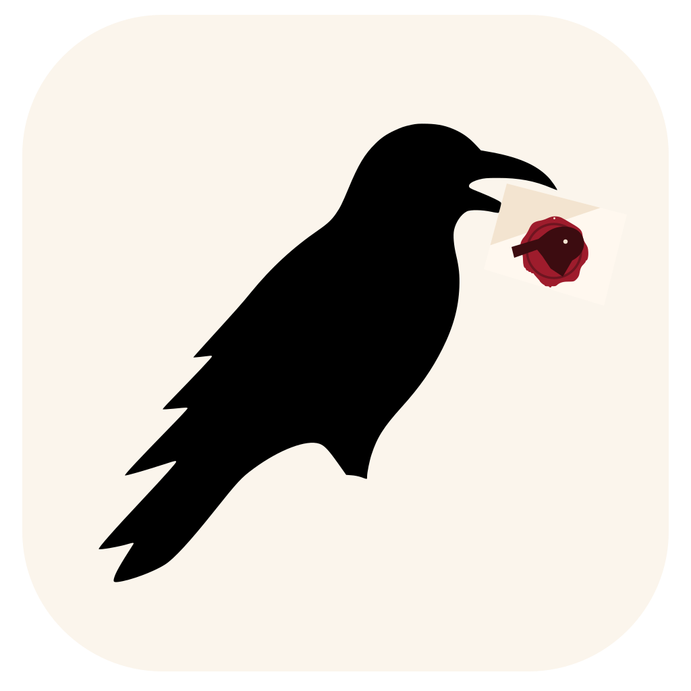

<p align="center">
  
</p>

<h1 align="center">Kuzgun</h1>

<p align="center"><strong>WhatsApp, native and fast.</strong><br>A lightweight WhatsApp app for Linux, macOS, and Windows.</p>

<p align="center">
  <a href="https://github.com/kaptanoguz/Kuzgun"><strong>Download</strong></a> ·
  <a href="https://github.com/kaptanoguz/Kuzgun">Getting started</a> ·
  <a href="https://github.com/kaptanoguz/Kuzgun">User guide</a> ·
  <a href="CONTRIBUTING.md">Contribute</a>
</p>

<p align="center">
  <a href="Cargo.toml"></a>
  <a href="https://github.com/kaptanoguz/Kuzgun"></a>
  <a href="LICENSE"></a>
</p>

Kuzgun (Turkish for raven) is a fork of [ZapFast](https://github.com/crmne/zapfast) by [crmne](https://github.com/crmne). It is a WhatsApp client written in Rust with
[egui](https://www.egui.rs) and [fastframe](https://fastframe.dev), the
framework behind a family of native desktop apps. It links to your phone as a
companion device through
[whatsapp-rust](https://github.com/oxidezap/whatsapp-rust) and has no browser
engine. In our Linux test it opens in under a second and uses about 200 MB of
idle RAM, against 1.13 GB for WhatsApp Web.
[See the measurements](https://github.com/kaptanoguz/Kuzgun).

The interface is available in English, Chinese (Simplified and Traditional),
Dutch, French, German, Indonesian, Italian, Portuguese (Brazil), Russian,
Spanish, and Turkish.

<picture>
  <source media="(prefers-color-scheme: light)" srcset="docs/screenshot-light.png">
  
</picture>

<details>
<summary><strong>Watch Kuzgun in action</strong></summary>

https://github.com/user-attachments/assets/2bf86b54-45fc-4add-8de7-c426c3cdad9b

</details>

[Features](#your-chats-on-your-desktop) · [Install](#install) · [Link your phone](#link-your-phone) · [Help](#guides-and-help)

## Your chats, on your desktop

| Feature | What you can do |
|---|---|
| **Messages** | Send formatted text, replies, edits, reactions, forwards, pictures, files, stickers, GIFs, polls, and voice messages. |
| **Media in the chat** | Play voice messages, videos, round video messages, GIFs, and animated stickers in place. |
| **Your history** | Keep your chats in an encrypted archive on this computer, fetch older messages from your phone as you scroll, and export locally saved chat history as text or a ZIP with downloaded attachments. |
| **Several numbers** | Link more than one WhatsApp number and switch between them in one window. |
| **Desktop controls** | Use keyboard shortcuts, select and copy text across messages, and stay linked in the tray with notifications. |
| **Themes** | Choose light, dark, system appearance, or custom colours. On Omarchy, follow your desktop theme. |
| **Privacy** | Hide locked chats behind a code, or the whole window behind an app lock. Nothing goes to a server of ours. |

## Install

| Platform | Installation |
|---|---|
| **macOS** | [Download a release](https://github.com/kaptanoguz/Kuzgun/releases). |
| **Arch Linux** | `yay -S kuzgun-bin` |
| **Windows** | Choose your build on the [Download page](https://github.com/kaptanoguz/Kuzgun). |
| **Other Linux** | Find Nix, AppImage, and other options on the [Download page](https://github.com/kaptanoguz/Kuzgun). |
| **From source** | Follow [Getting started](https://github.com/kaptanoguz/Kuzgun) for dependencies and commands. |

## Link your phone

1. Open Kuzgun. It shows a QR code.
2. On your phone, open WhatsApp, then **Settings**, **Linked devices**,
   **Link a device**, and scan the code. Or click **Link with phone number**
   and enter the eight-character code on your phone.
3. Your recent chats arrive from the phone. Older messages follow as you
   scroll up.

The link survives restarts, and your phone does not need to stay online to
read what Kuzgun has already stored. See
[Getting started](https://github.com/kaptanoguz/Kuzgun) for the full
walkthrough and [How it links](https://github.com/kaptanoguz/Kuzgun) for the
details.

## Guides and help

The guide in this repository starts at [docs/index.md](docs/index.md). Releases are on [GitHub](https://github.com/kaptanoguz/Kuzgun/releases).

| You want to… | Read |
|---|---|
| Know what Kuzgun does and does not do yet | [What is Kuzgun?](https://github.com/kaptanoguz/Kuzgun) |
| Link your phone or build from source | [Getting started](https://github.com/kaptanoguz/Kuzgun) |
| Learn messages, stickers, polls, and shortcuts | [Using Kuzgun](https://github.com/kaptanoguz/Kuzgun) |
| Find settings, stored files, encryption, the app lock, and updates | [Settings and files](https://github.com/kaptanoguz/Kuzgun) |
| Make your own theme | [Making a theme](https://github.com/kaptanoguz/Kuzgun) |
| Understand what stays on this computer | [How it links](https://github.com/kaptanoguz/Kuzgun) |
| Understand account risk | [Account safety](https://github.com/kaptanoguz/Kuzgun) |
| Report a bug or propose a feature | Read [Contributing](CONTRIBUTING.md), then use the [issue forms](https://github.com/kaptanoguz/Kuzgun/issues/new/choose). |

## Contributing

Read [CONTRIBUTING.md](CONTRIBUTING.md) before opening an issue or pull
request. To look at the interface without a WhatsApp account, run:

```sh
cargo run --features demo -- --demo
```

[AGENTS.md](AGENTS.md) describes the architecture, [DEMO.md](DEMO.md) the
demo pages, screenshots, and recorded tours, and
[PACKAGING.md](PACKAGING.md) releases and packages.

Native notifications use Fastframe on Linux, macOS and Windows. Kuzgun keeps
its account/chat routing, privacy settings, notification limits and sound
previews. Clicks open the announced message; reading a chat withdraws its
tracked notifications. OS permissions and notification presentation still apply.


## More native apps

**Want Spotify just as fast and native?** [Spotifast](https://spotifast.rocks)
is Kuzgun's sibling. Both are built on
[fastframe](https://fastframe.dev).

## Acknowledgements

Kuzgun uses [whatsapp-rust](https://github.com/oxidezap/whatsapp-rust),
[egui](https://www.egui.rs), [fastframe](https://fastframe.dev), the
[Inter](https://rsms.me/inter/) typeface and Noto Color Emoji (OFL), and
[Lucide](https://lucide.dev) icons (ISC), also used for the chat wallpaper
doodles. The notification sounds are [Pidgin](https://pidgin.im)'s, under the
GPL-2.0 (see `assets/sounds/`).

Kuzgun is an unofficial client and is not affiliated with WhatsApp or Meta.
Using an unofficial client may be against WhatsApp's terms of service and
could get an account suspended. Use it at your own risk. WhatsApp is a
trademark of WhatsApp LLC.

Licensed under the [MIT License](LICENSE).

## Star history

<a href="https://www.star-history.com/?repos=crmne%2Fkuzgun&amp;type=date">
  <picture>
    <source media="(prefers-color-scheme: dark)" srcset="https://api.star-history.com/chart?repos=kaptanoguz/Kuzgun&amp;type=date&amp;theme=dark">
    
  </picture>
</a>
